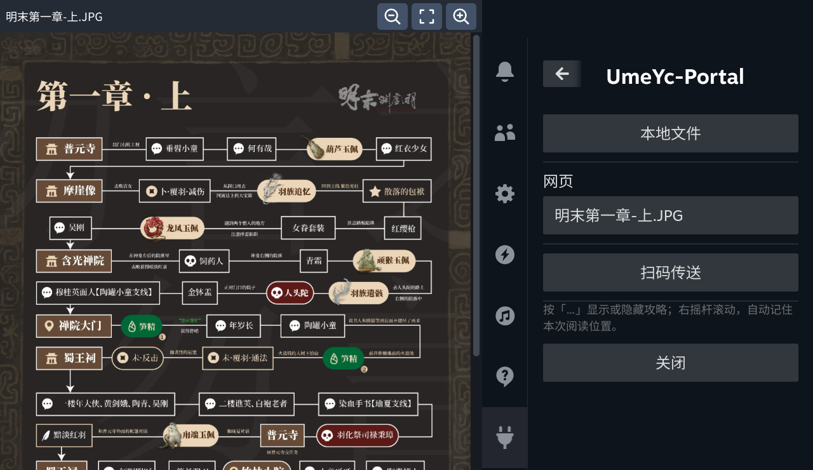
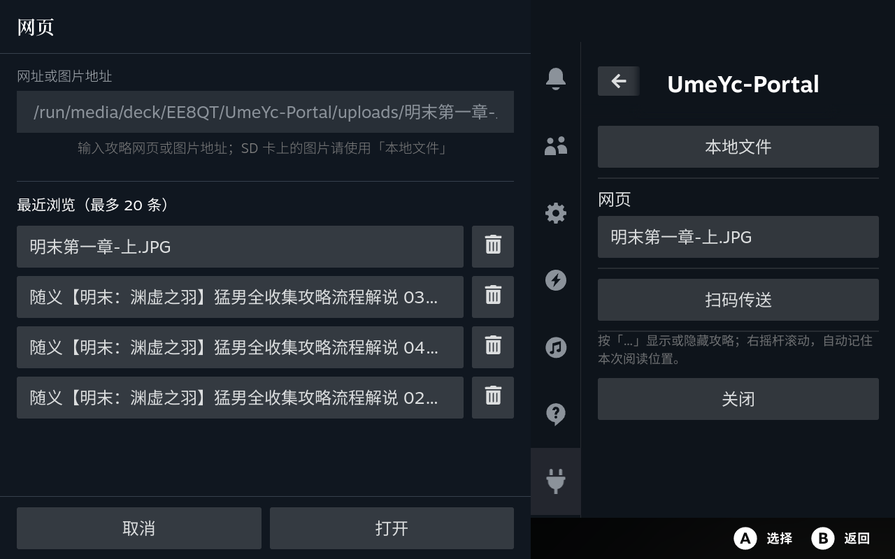

# UmeYc-Portal

在 Steam Deck 游戏模式中打开网页、阅读本地攻略长图，支持随侧栏显示、右摇杆滚动，以及扫码发送网址或上传图片。

> **接手这个项目（新电脑解压后）**
>
> 当前版本 `1.0.0-zh-cn.48`。对 Claude Code 说：**先读 README.md，再按里面的顺序接手这个项目。**
>
> 阅读顺序：
> 1. 本文件「功能 / 安装」：快速了解插件能力；
> 2. [HANDOFF.md](HANDOFF.md)：**最重要的进度文档**——当前状态、实机待验证项、环境搭建、构建/发布流程、已知坑、文件地图；
> 3. [CLAUDE.md](CLAUDE.md)：代码架构、状态管理和开发约定；
> 4. 按需读 `docs/OFFLINE_CAPTURE_VERIFICATION.md`（离线抓取）和 `docs/LOCAL_ATLAS.md`（地图册）。
>
> 新电脑先装 Node.js ≥ 22、Python ≥ 3.9，然后在项目根执行 `corepack pnpm@9.15.9 install --frozen-lockfile`。`out/UmeYc-Portal.zip` 是可直接安装的 .48 构建；完整 git 历史在 `.git` 中。

[English / 上游说明](README.en.md) · [实机验证记录](docs/LOCAL_FILES_VERIFICATION.md)



## 功能

- **中文界面**：设置、网页栏和提示均已汉化。
- **本地攻略**：在游戏模式浏览 SD 卡或内置存储上的攻略，支持打开和删除；删除前显示文件名确认，成功后同步清理历史。
- **随侧栏显示**：按「…」展开快捷栏，攻略铺满左侧剩余区域；再按一次同步隐藏。
- **随插件页显示**：在 Decky 里点开 UmeYc-Portal 时显示网页阅读器；按 Deck 的返回键回到 Decky 插件列表后自动收起，不再占用左侧区域。
- **左侧操作面板**：网页（地址与历史）、扫码、文件管理和文件夹选择均在左侧阅读区域切换；右侧插件栏保持展开，关闭面板后恢复攻略。
- **统一关闭**：点击右侧「关闭」会同时关闭阅读器和当前操作面板，包括网页地址/历史、扫码或本地文件；再次「打开」仅恢复当前页面。
- **开关记忆**：记住阅读器的打开/关闭状态，重启系统或重载插件后恢复；首次安装及从未保存过开关状态的旧版本升级后默认关闭。进入插件设置不会自动打开阅读器，选择网页、本地文件或接收扫码内容后才会打开。
- **缩放快捷键**：图片和网页显示时，L1 缩小、R1 放大、L3（按下左摇杆）恢复默认，与顶部三个图标一致。每次按下触发一次；侧栏收起、打开操作面板或 Steam 系统弹窗时暂停响应。
- **右摇杆滚动**：网页和本地攻略长图均可上下滚动，支持水平滚动；推动幅度控制速度。网页使用原生滚轮事件，滚动目标为页面中央的内容区。
- **手机版网页**：设置页开关；开启后向网站请求手机版页面（Android UA + 触摸模拟 + 移动视口），适合窄侧栏阅读；切换时当前网页刷新一次。手机版下缩放按钮自动隐藏、L1/R1/L3 不缩放（移动版布局已适配宽度），关闭开关后恢复缩放。
- **缩放不留白**：缩小 B 站、小黑盒这类整屏网页时，占满屏幕的外层容器会同步拉高，底部不再出现大片空白；恢复默认时还原。
- **阅读位置记忆**：按文件记住本次运行期间的位置和缩放；重新打开可接着看，插件重载或重启后清空。
- **扫码传送**：整行文字按钮打开临时二维码，同一 Wi-Fi 下发送网址或上传本地图片；支持选择保存文件夹，默认优先 SD 卡，否则用内置存储。
- **扫码自动离线保存**：收到网址后等待页面加载，把当前网页保存为离线集合（文字、样式、图片）；小黑盒类页面还会把正文里的一级文章链接（最多 30 个）一起保存为本地子页面，断网也能点开；可在设置中关闭。
- **自动检查更新**：打开设置时（每小时最多一次）检查本 fork 的 GitHub Releases；发现新版本会自动下载 ZIP 到 `Downloads`，替换旧的 `UmeYc-Portal.zip`，并提示到 Decky 安装。也可手动点「检查并下载更新」。插件只负责下载和校验，不会自动安装；网络异常时最多约 95 秒会给出失败提示，不会一直卡在「正在检查」。
- **离线网页集合**：在「本地文件」中打开、整目录删除；部分资源未能保存时标记为「部分保存」。
- **离线地图册**：引用 SD 卡或内置存储中的静态地图册文件夹（例如《女王魔域》2D/3D 地图册），在阅读器内打开 2D、3D 和物品查询；地图册数据不复制、不打包，只读本地服务。
- **地图蒸汽键盘搜索**：地图册页面打开时，网页标题栏右侧出现「搜索」按钮（设置页也有「地图搜索」）；点击后直接呼出 Steam 屏幕键盘，中文候选词显示在键盘上方，按键盘上的「搜索」键即写入当前地图/物品搜索框。插件直接接管键盘的按键和 IME 提交回调，不再依赖网页输入框接收文字，避免候选词被挡或选词丢失。若 Steam 键盘不可用，可在弹窗中改用手机扫码输入；地图页自带的输入框为只读，点击会提示用顶部按钮。
- **地图页面不缩放排版**：地图册页面隐藏插件的网页缩放按钮，L1/R1 也不发送网页缩放；地图用双指捏合或地图自带 +/− 缩放，不会把页面挤成竖屏。
- **全触屏地图手势**：地图册注入手势层，单指拖动/点击保持原样，双指捏合缩放、双指拖动平移；2D 和 3D 地图都支持，不改地图册原文件。
- **保存位置迁移**：更换图片/离线网页的保存位置时，可选择把旧位置的图片和离线网页无损迁移过去，支持后台进度、取消和失败重试。
- **网页与历史**：设置页「网页」下方显示页面 title，长标题单行省略；点击后在同一面板上方编辑地址、下方选择最近 20 条记录。移除独立的历史按钮，扫码传送保留独立文字按钮。
- **最近浏览**：保存最近 20 条网页或本地文件记录，重复访问移到最前；网页显示页面标题，本地文件显示中文文件名。网页内切换下一集时同步实际网址与标题，并新增历史，保留上一集；同步不会刷新视频。每项右侧可删除记录（保留文件）。没有标题时显示「未命名网页」。
- **中文文件名**：本地文件在「网页」行和历史中显示原始中文名称，编辑时显示可读路径。
- **R3 视频全屏**：网页中可启用「按下右摇杆切换视频全屏」，按一次发送 F，切换视频全屏；仅在网页可见时生效，需网站支持 F 快捷键，默认关闭。
- **全屏视频摇杆控制**：视频全屏时右摇杆左右快退/快进、上下提高/降低视频音量；退出全屏后恢复网页滚动。使用网站方向键快捷键，B 站同时支持原生全屏与网页全屏；持续推动约每 250 毫秒重复一次，斜推采用幅度较大的方向。
- **随侧栏播放/暂停**：网页侧栏模式可选自动发送空格，展开后继续、收起前暂停；默认关闭。

当前版本：`1.0.0-zh-cn.48`。基于官方稳定标签 `v0.1.1`，保留上游提交历史和 BSD-3-Clause 许可证。

## 使用

按 Steam Deck 的「…」键，进入 **Decky → UmeYc-Portal**。

### 本地攻略

1. 选择「本地文件」，默认打开当前图片上传目录；可用「选择文件夹」切换位置。
2. 每个文件右侧可删除文件，需确认文件名，成功后同步清理历史。「网页」面板最近浏览中的删除按钮只移除记录。
3. 默认随侧栏显示，边玩边按「…」呼出、收起攻略。
4. 用右摇杆或触屏滚动；顶部右侧的缩小、默认、放大图标调整图片宽度；默认恢复适宽。

图片顶部图标只调整图片缩放；触屏进入图片页后，窗口仍保持原来的高度。设置页仅保留随侧栏显示，移除了布局、展开、控制栏及小窗位置、大小、边距选项。

图片支持 JPG/JPEG、PNG、GIF、WebP、BMP、SVG、AVIF、ICO，文件名后缀大小写均可。PDF、HTML、TXT、MD 也可选择，由 Steam 浏览器处理；实机验证以 JPG 长图为主。HTML 仅支持单文件内容，不开放相邻资源目录。

### 网址与扫码输入

网页显示期间约每秒同步一次实际网址和标题。B 站切集时优先读取当前视频标题，避免浏览器 title 残留上一集；历史按视频及分 P 去重，忽略分享和追踪参数。首次打开短链接后以实际页面地址保存，后续切集新增记录，重复访问移到最前。



- 点击「网页」下方的标题：在左侧同一面板编辑完整地址，或直接选择下方的最近浏览记录；每条记录仍可单独删除。
- 点击独立一行的 **扫码传送** 按钮：显示二维码弹窗。
- 让扫码设备和 Deck 连接同一 Wi-Fi，用相机扫码并在浏览器中打开。
- 在页面粘贴网址点「发送网址」，或选择图片点「上传图片」；完成后 Portal 自动打开。
- Deck 扫码窗口中的「图片保存位置」可选文件夹并记住，也可恢复自动选择。自动位置优先 SD 卡的 `UmeYc-Portal/uploads`，无 SD 卡时为内置存储的 `Pictures/UmeYc-Portal`。手动选择的 SD 卡拔出后提示重新选择。
- 自动选择时也显示最终完整路径；「本地文件」使用同一个目录，上传、打开、删除在同一位置完成。
- 上传支持 JPG/JPEG、PNG、GIF、WebP、BMP、AVIF、ICO，每张不超过 64 MB，显示上传进度；保留中文文件名，同名自动编号，传输中断清理未完成文件。

二维码每次可发送一个网址或一张图片，**5 分钟后过期**；关闭弹窗即取消，点「刷新二维码」可重新生成。网址支持 `http://`、`https://`，未填写协议时默认补上 `https://`。访客 Wi-Fi 的设备隔离、VPN 路由或防火墙可能影响连接。

设置中的「扫码后自动离线保存」默认开启。扫码发送网址后，Portal 会等待页面加载并保存当前页面，进度和失败原因显示在「本地文件 → 离线网页」。小黑盒正文里的一级文章链接会一并保存为本地子页面（最多 30 个），正文里的这些链接会改为本地页面；子页面里的更深链接不递归，视频不下载。保存链接期间阅读器会暂时隐藏，避免中间页面写入浏览历史，完成后自动恢复；超长页面无法生成快照时会退化为整页截图。

更换保存位置时，如果旧位置还有图片或离线网页，会提示「迁移并更换」「仅更换」或「取消」。迁移在后台执行，同名文件自动编号、不覆盖，失败项留在原位置并可在「本地文件」中重试。

二维码在 Deck 本机生成；只在打开扫码弹窗时启动临时局域网接收服务，带随机访问令牌。收到内容、取消、过期或卸载时关闭服务。它仅接收本次发送的网址或图片，不向局域网提供 Deck 本地文件，也不经过外部中转服务。

### 离线网页

1. 扫码发送网址后，Portal 自动等待页面加载并开始保存；设置中可以关闭。
2. 打开「本地文件」，顶部「离线网页」会出现已保存的集合；点击打开，删除会连同页面和图片一起删除。断网后重新点击已保存的网页地址会自动打开本地副本；也可以从「本地文件 → 离线网页」直接打开。
3. 保存的是静态快照：脚本被移除，视频不下载；小黑盒类页面会额外保存一级文章子页面，更深链接不递归；交互、登录和收藏在离线状态下不可用。

### 离线地图册（可选）

1. 把地图册压缩包解压到 SD 卡或内置存储，例如 `/run/media/deck/SD/女王魔域地图册/`；选择包含 `index.html` 的那层文件夹（选择外层且只有一个子目录时也会自动进入）。
2. 打开「本地文件与地图册」→「离线地图册」→「选择地图册文件夹」；校验通过后会出现「2D 地图」「3D 地图」「物品查询」按钮。
3. 地图在阅读器中打开；触屏单指拖动/点击标记，双指捏合缩放，双指拖动平移，和手机地图一致。要搜索时点网页标题栏右侧的「搜索」按钮（或设置页的「地图搜索」），会直接弹出 Steam 屏幕键盘；输入关键词后按键盘上的「搜索」键，结果会自动写入地图/物品的搜索框。键盘打开期间左侧面板会收起为顶部的一条输入提示，避免挡住中文候选词；收起键盘可返回弹窗，继续输入或改用手机扫码。
4. 地图册数据不会被复制、修改或随插件删除；请自己保留文件夹。地图册包含游戏素材，仅供个人使用，请遵守其 `COPYRIGHT.md`。
5. 3D 地图需要 WebGL；如果整机性能紧张，可在地图内把画质调为「流畅」，或先使用 2D 地图。

### 网页视频随侧栏播放/暂停

打开支持空格播放/暂停的视频网页，先暂停视频，再启用「随侧栏播放/暂停」。从下一次按「…」切换侧栏开始，收起攻略前发送一次空格暂停，展开后发送一次空格继续。打开设置弹窗不会切换播放状态。

此功能发送网页的空格快捷键，不能直接判断站点视频是否正在播放。若手动切换过播放状态，请先关闭开关、暂停视频后重新启用；输入框持有焦点时也应先退出输入。没有空格快捷键的网站不适用。

## 安装

需要先安装 [Decky Loader](https://decky.xyz/)。

1. 下载或自行构建 `UmeYc-Portal.zip`，复制到 Deck。
2. 打开 Decky 设置，选择「从 ZIP 文件安装插件」。
3. 选择 ZIP 并确认安装，随后在 Decky 中打开 Portal。

设置页的「检查并下载更新」会从本 fork 的 GitHub Releases 下载最新 ZIP 到 `/home/deck/Downloads/UmeYc-Portal.zip`；打开设置时也会自动检查（1 小时最多一次）。下载完成后在 Decky 的「从 ZIP 文件安装插件」中选择该文件即可，插件不会自动安装。无法访问 GitHub 时会在提示中显示失败原因，仍可手动下载。

插件名称为 `UmeYc-Portal`。从旧版 `Portal` 迁移时，先卸载旧插件再安装本版；原有网址、位置、大小和历史使用相同的存储键保留。

## 从源码构建

环境：Node.js ≥ 22、pnpm ≥ 9、Python ≥ 3.9。

```sh
pnpm install --frozen-lockfile
pnpm lint
pnpm format:check
pnpm exec tsc --noEmit
pnpm test:coverage
python3 -m unittest discover -s tests -v
pnpm build
python3 scripts/package.py
```

安装包位于 `out/UmeYc-Portal.zip`，包含前端、Python 后端和图片/扫码页面资源。请安装完整 ZIP，不要只替换 `dist`。

### 网页双指缩放

网页顶部显示当前页面标题，右侧为缩小、默认、放大三个图标，与本地图片一致。网页按钮调整排版缩放，范围为初始尺寸的 25%–300%，可以缩到比原始页面更小；默认恢复初始排版并重置双指放大。图片的默认按钮恢复适宽。

双指手势仍使用 Chromium 原生缩放，手势自身通常只能缩回初始尺寸。顶部栏独立于网页缩放，始终保持可点击大小；收起侧栏后随网页一起隐藏，重新展开保留当前缩放，页面刷新或跳转后从默认尺寸开始。

## 运行方式与限制

Portal 复用 Steam 的 Chromium/CEF 浏览器。静态攻略主要占用图片解码和浏览器内存；没有持续滚动时不运行动画或滚动 RPC，图片隐藏时停止摇杆订阅。尚未对总内存增量、功耗或游戏帧率进行对照测量。

网页摇杆滚动复用 Decky 已使用的本机 CEF 调试接口，不新增网络监听；网页隐藏时关闭滚动连接。同一网址若同时存在多个无法区分的浏览器页，会提示重新打开，避免误滚其他页面。独立滚动面板或跨域内嵌内容以页面中央接收滚轮的区域为准。

本地文件预览始终只监听 `127.0.0.1` 的随机端口，仅允许访问明确选中的文件。阅读位置仅保存在进程内存，不写入磁盘。拔出 SD 卡后需插回同一张卡，或重新选择文件。

窗口、侧栏和原始手柄输入依赖 Steam 当前的内部接口；后续 Steam 更新可能需要适配。

## 来源与许可

- 本分支：[xiaochaom/UmeYc-Portal](https://github.com/xiaochaom/UmeYc-Portal)
- Portal 上游：[ajustinjames/decky-portal](https://github.com/ajustinjames/decky-portal)，稳定基线 `v0.1.1`（`023cc39efb1004797291d2269e07fca72def4dba`）。
- 原始插件基础：Ross Squires 的 [decky-pip](https://github.com/rossimo/decky-pip)。Portal 品牌与上游开发：Aaron James。
- 项目许可：[BSD-3-Clause](LICENSE)。二维码生成使用 MIT 许可的 `qrcode-generator`。
